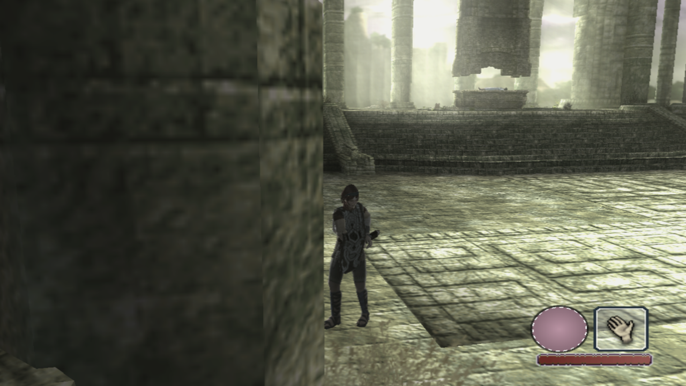
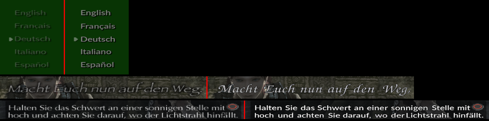
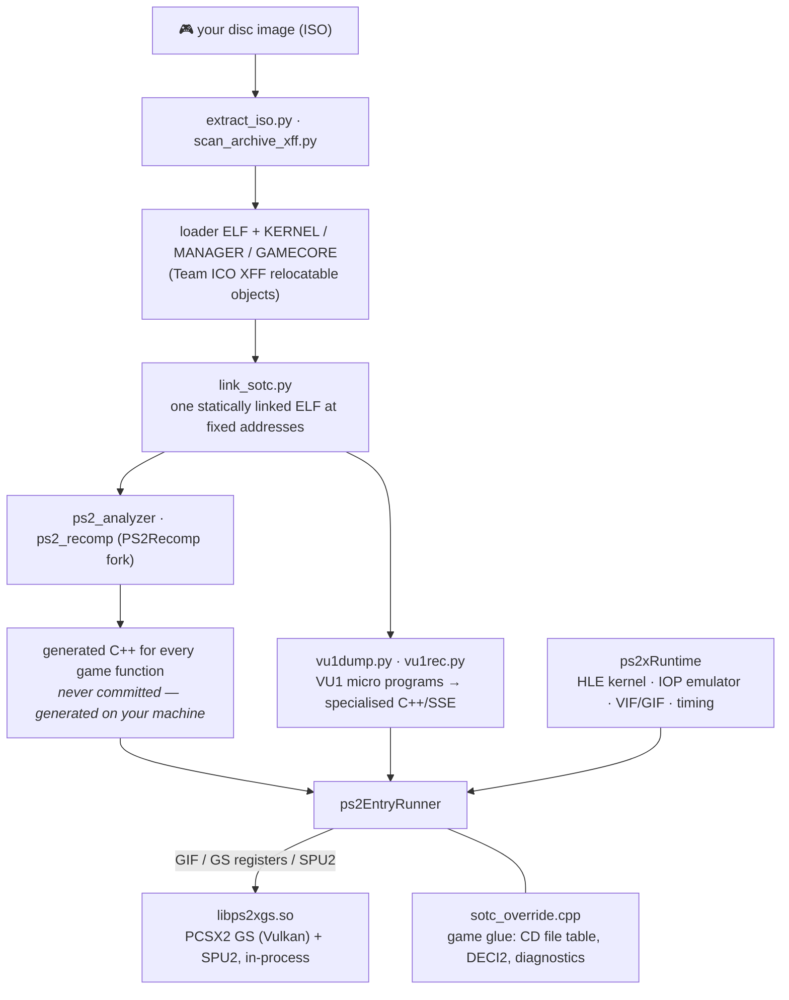

<div align="center">

# Shadow of the Colossus — Native Linux Port

**Static recompilation of the PS2 classic into a native Linux executable.**<br>
No CPU emulation at runtime · bit-exact against the console reference · built to be remastered.

[](#known-issues)
[](#building)
[-lightgrey)](#legal)
[](LICENSE)
[-purple)](gsbridge/)
[](#how-this-was-built)



<sub>Shrine of Worship — native port, PCSX2 GS renderer at 3× internal resolution, 50 FPS PAL / 60 FPS NTSC mode.</sub>

</div>

---

> ⚠️ **Work in progress.** This is an active, fast-moving project, not a release. Expect rough edges,
> missing features and breaking changes between commits. See [Known issues](#known-issues).

**This repository contains no game code, no game assets and no BIOS.** You need your own disc. The
pipeline in this repo turns *your* dump into *your* build on *your* machine (see [Legal](#legal)).

## At a glance

| | | |
|---|---|---|
| 🧠 **How it runs** | The game's MIPS R5900 code, VU0 macro code and VU1 micro programs are translated to C++ ahead of time and compiled into an ordinary executable. | no interpreter, no JIT |
| 🎨 **How it draws** | PCSX2's GS renderer and SPU2 are linked in-process as a library (Vulkan, internal upscaling, texture replacement). None of PCSX2's CPU emulation runs. | [`gsbridge/`](gsbridge/) |
| 📏 **How it's checked** | Input recordings replay frame-exactly; RAM snapshots are compared word by word with PCSX2 savestates on the same route; three runs under full load are bit-identical. | [docs/VERIFICATION.md](docs/VERIFICATION.md) |
| 🚀 **How fast** | One frame per VBlank — 50 FPS (PAL) / 60 FPS (NTSC mode) in the open world at 3× internal resolution. | [numbers](#numbers) |
| 🔤 **How it looks sharp** | Menu/subtitle textures are re-typeset at 4× with real fonts — no AI upscaling. | [`tools/textseite_neu.py`](tools/textseite_neu.py) |

### Status

| Area | State | Notes |
|---|---|---|
| Boot, intro, title/language/60 Hz menus | ✅ | |
| Open world, riding, climbing, save/load | ✅ | verified bit-exact vs. PCSX2 on recorded routes |
| Sound & music (SPU2 + real IOP driver) | ✅ | |
| Quit game / soft reset | ✅ / 🚧 | "New Game" from a running game untested |
| Full-speed in colossus fights | 🚧 | all 21 VU1 programs of the game are now compiled ahead of time (statically, from the game files); play-test pending |
| HD text | 🚧 | German pages of the intro/menus done, rest pending |
| Settings menu, rumble, installer | ⬜ | planned |
| Other regions (NTSC-U/J) | ⬜ | would need a new module layout |

---

## Why this port is different

Most PS2 "recomp" projects stop at "it boots". This one was built as a **remaster foundation**: every
emulation detail that influences game behaviour was measured against a reference (PCSX2 and public
hardware documentation) and fixed at the root — in the recompiler, not with per-game hacks.

| Area | What was done |
|---|---|
| **Recompiler correctness** | Audited every FPU, VU0-macro and MMI instruction the game actually uses (instruction census over the whole linked ELF) against PCSX2 and hardware test vectors. Found and fixed **10 translation bugs** in the upstream recompiler (see [Findings](#findings-and-fixes-in-other-projects)). |
| **Bit-exact physics** | Player position, camera position and camera basis match PCSX2 to the last printed digit on the same input recording (deterministic replay system with RAM snapshots at the pad poll). |
| **Deterministic** | Three identical runs under full machine load produce bit-identical frames, with the VU1 and GS running on their own threads. |
| **Native frame rate** | The game has no internal frame cap (`IVSync = 0`). The port renders one frame per VBlank: 50 FPS in PAL mode, 60 FPS when 60 Hz is selected in the game's own options menu. Physics stays correct because the game scales its time step by video mode itself. |
| **VU1 ahead-of-time compiler** | VU1 micro programs are dumped from the game, statically analysed (flag liveness, register readiness, branch delay quirks) and compiled to specialised C++/SSE. Equivalence to the cycle-accurate interpreter is checked with a built-in differential tester. |
| **Multithreaded** | VIF1/VU1 work runs on a worker thread (like PCSX2's MTVU), the GS on its own thread. |
| **HLE kernel without side effects** | The high-level kernel (threads, semaphores, SIF/RPC, memory card, CD) keeps all of its own state outside game RAM — an earlier layout clobbered the game heap and broke "Quit game". |
| **Real IOP** | IRX modules are executed by an IOP emulator with its own RAM (sound driver, CD streaming), with HLE only where a module talks to real hardware. |
| **HD text without AI** | Menu and subtitle textures are re-typeset: text lines are detected in the original textures, read with OCR, corrected, and re-rendered with free fonts at 4× resolution in the original layout. No AI upscaling ("AI slop") anywhere. See the [before/after](#hd-text-before--after) below. |
| **Input recording / replay** | Every bug report becomes a replay. The test harness runs dozens of replays in parallel, compares screenshots pixel-by-pixel across builds, and dumps RAM at chosen frames for comparison with PCSX2. |

### Correct vs. "looks right"

Some of the things that were found by comparing against the reference instead of eyeballing:

- `SQRT.S` was translated with the wrong source register (`fs` instead of `ft`). 67 of 137 sites computed
  the wrong root. Visible effect: the player could not walk — the analogue stick strength was wrong.
- `MOVZ`/`MOVN` wrote the full 128-bit register; the hardware writes only the lower 64 bits (1462 sites).
- `VDIV` by zero returned ±0 instead of ±MAX; `VMAX`/`VMINI` used host float compares instead of the
  integer compare the VU does (±0 and huge values differ).
- `PMULTW`, `PMTHI`, `PMTLO`, `PMFHL` were translated with 32-bit semantics — the colour/brightness
  math (`iosMulMvec`) was wrong.
- `SQRT.S` must round to nearest (like PCSX2's `recSQRT_S`) while every other FPU op truncates; 1 ulp
  difference flipped the exposure to white and made hair, reins and the player's movement drift.
- `rand()`, `sinf()`/`cosf()` and friends were replaced by bit-exact re-implementations of the PS2
  newlib routines (`k_sinf.c`, `k_cosf.c`, `e_rem_pio2f.c`, the 64-bit LCG) so random dust emitters,
  wind and animation match the console.
- The VU0 random-number instructions (`VRNEXT`/`VRINIT`/`VRXOR`) were not implemented with the hardware
  LFSR; `iosGetRandom` returned 0 or garbage, dust emitters never ended, and the heap leaked ~5 KB per
  puff until the game ran out of memory after ~8,700 frames.
- The H-blank timer ran at NTSC speed on a PAL game; the PAL rate is 15625 Hz.
- Interrupt handler stacks were placed on the game's main stack; HLE pools lived in game RAM.

### HD text: before / after

<div align="center">

<br><sub>Left: original 128–512 px texture pages as the game ships them. Right: the same pages re-typeset at 4× (TeX Gyre Heros / TeX Gyre Chorus), button icons kept from the original.</sub>
</div>


### VU1 optimisation log (one day, every step bit-exact)

Every step is accepted only if a differential run against the cycle-accurate interpreter shows **0 mismatches
over 7.26 million VU1 program invocations** and 36/36 regression screenshots are pixel-identical.

| Step | VU1 thread CPU time | |
|---|---|---|
| Baseline (stage-5 compiler) | 83.2 s | |
| Remaining lower ops translated directly (DIV/RSQRT/SQRT/WAITQ, clip/status/MAC flag tests, MTIR/MFIR/ILWR/XTOP) — 389 interpreter fallbacks in the hot path → 0 | 76.7 s | −8 % |
| Leaner bookkeeping: no upper-opcode tracking in the fast path, dominated "pending result" updates removed per block, branch-VI backup inline | 72.6 s | −13 % |
| Cycle skipping to the next pipeline event; XGKICK copies whole GIF tag payloads instead of 16 bytes at a time | 70.1 s | −16 % |
| Clip flags through a small in-block ring instead of the generic flag pipeline; VIF1 `UNPACK` specialised per format (no mask, CL/WL fast path — 176 M unpacks checked against the generic path) | 69.1 s | −17 % |
| Profile-guided build of the above (`pc143`) | 63.1 s | −24 % |
| Sticky status bits (`0xFC0`) dropped: a whole-program scan proves no VU1 program of this game ever reads them (all `FSAND` masks are `0x002`, `FMAND`/`FMEQ` read MAC, no `FCSET`) — without PGO | 59.0 s | **−29 %** |
| Interpreter → compiled re-entry at the next block entry after a coverage gap (`pc149`) | – | colossus fix |
| **All VU1 code compiled statically** (`pc154`): modules read from the game files, entries from each module's jump table and `MSCNT` continuations, reachability like PCSX2's microVU; programs recognised by a signature of exactly the bytes they compile, so leftovers of previously loaded modules no longer cause misses. 7,666 → **33,837** compiled instruction pairs, 11 → **21** programs | – | ✓ |
| Tried and rejected: a leaner FMAC core with normalised register shadows ("stage 6") — correct, but 8–15 % *slower* (code size / spills) | 89.8–95.6 s | ✗ |

Measured with the thread's own CPU clock (`CLOCK_THREAD_CPUTIME_ID`), solo, same replay, no PGO noise.

---

## Findings and fixes in other projects

Everything below was found while porting this game and verified against PCSX2 source / hardware docs.
The fixes live in this repository (`patches/`, `recomp/`) and are offered upstream where applicable.

**PS2Recomp (static recompiler)**
- `COP1 SQRT.S` reads `ft`, not `fs`
- `MOVZ`/`MOVN` write 64 bits, upper half preserved
- `PMULTW`: two signed 32×32→64 products into LO/HI and LO1/HI1 (not four unsigned ones summed)
- `PMTHI`/`PMTLO`/`PMFHL.LW/UW` full 128-bit semantics
- `VDIV`: ±MAX on division by zero, clamp on overflow; `VSQRT`/`VRSQRT` hardware special cases
- `VMAX`/`VMINI`: integer compare semantics
- `PADDUH`/`PSUBUH`: saturating
- `SQRT.S` round-to-nearest, all other FPU ops truncate (and `DIV.S` to nearest)
- VU0 macro `VRNEXT`/`VRINIT`/`VRXOR` with the hardware LFSR (patch in `patches/`)
- HLE kernel: callback/interrupt stacks and RPC/TLS pools must not live in game RAM
- Self-modifying `jal 0` in the game's loader (patched at runtime by the game itself) must be read
  from RAM instead of being baked in by the recompiler

**PCSX2 (used as the reference, and as the GS/SPU2 library)**
- A small in-process bridge (`gsbridge/`) that feeds GIF/VIF data into PCSX2's GS and SPU2 without
  running any of its CPU emulation (patch against a pinned PCSX2 commit).

---

## Architecture



Details: [docs/ARCHITECTURE.md](docs/ARCHITECTURE.md). Verification method: [docs/VERIFICATION.md](docs/VERIFICATION.md).

---

## Numbers

| | |
|---|---|
| Project start | 1 November 2026 |
| Builds | 180+ numbered runtime builds (`pc1` … `pc148`), with profile-guided optimisation |
| Test runs | 1,231 automated runs through the job queue (replays, differential VU1 tests, RAM comparisons, PCSX2 reference runs), up to 28 in parallel |
| Reference comparisons | PCSX2 2.8.2 driven by a virtual game pad over PINE, savestates compared word by word |
| Development machine | AMD Ryzen 9 7950X · AMD Radeon RX 7900 XT · CachyOS (Linux, KDE Plasma / Wayland) |
| Performance | 1 frame per VBlank (50/60 FPS) in the open world at 3× internal resolution. Unpaced benchmark (5,500-frame open-world replay): **73.8 FPS** (`pc148`), VU1 thread **59.3 s CPU** — down from 83 s through bit-exact compiler/runtime steps (see below) |

---

## Building

See [docs/BUILDING.md](docs/BUILDING.md). Short version (CachyOS / Arch):

```sh
tools/setup_cachyos.sh                 # toolchain + dependencies
SOTC_ISO=/path/to/your/own/dump.iso \
tools/pipeline.sh                      # ISO → modules → linked ELF → generated C++
tools/pc_bauen_pgo.sh pc1              # build the runtime (PGO: gen, play, use)
tools/run_game.sh                      # play
```

The GS/SPU2 library is built once from a pinned PCSX2 commit with `gsbridge/` applied
(`gsbridge/README.md`).

---

## Known issues

Honest list, as of early November 2026:

- **Frame drops in the first colossus fight (25–38 FPS, `pc148` and older).** The first real play session
  reached and fought the first colossus. From that area on, VU1 micro programs hit code paths that never
  appeared in our recordings; the compiled program fell back to the cycle-accurate interpreter and stayed
  there for the rest of the program (~8 M fallbacks in 10 minutes). Since `pc149` the interpreter jumps back
  into compiled code at the next block entry (checked bit-exact over 12.8 M invocations on a colossus replay),
  and the game records the missing code quietly while playing so the next build compiles it.
- **60 Hz mode stayed at 50 Hz** until `pc147`: the high-level `sceGsResetGraph` replacement never issued
  the `SetGsCrt` syscall, so the port missed the game's switch to NTSC timing. Fixed.
- **Performance headroom in the open world:** the VU1 thread needs ≈ 11 ms per frame of the 16.7 ms budget at 60 Hz.
- **"New Game" from inside a running game** (soft restart) is untested.
- **HD text** covers only the pages seen so far (language select, title/bonus menus, 50/60 Hz notice,
  first tutorial boxes, first subtitles) and only German so far; other languages and later pages still
  show the original low-resolution textures. OCR corrections are done by hand per page.
- **Widescreen** is a renderer-side setting; the game's own 4:3 camera framing is kept, so some
  cutscene framing differs from the console.
- The PCSX2 reference comparison shows a tiny constant difference in the camera "up" vector after the
  intro cutscene (±0.0007) caused by PCSX2's load stalls between cutscene segments; gameplay math itself
  matches.
- **Unit tests:** 435/446 pass. The 11 failures are test-bed assumptions (old CPU GS path, IOP heap
  address range, a VIF1 corner case that contradicts the hardware, VU1 flag tests that need
  `PS2X_VU1_FLAGS_ALWAYS=1`).
- No installer yet, no in-game graphics settings menu beyond the bridge's small overlay, rumble not
  wired up.
- PAL only. NTSC-U/J would need a new module layout and a re-run of the whole pipeline.
- The reference tool leaves PCSX2 processes behind on abnormal exits; savestates fail during FMVs.

---

## Tools built for this project

All in `tools/`, all ours unless noted:

| Tool | Purpose |
|---|---|
| `extract_iso.py`, `scan_archive_xff.py`, `xff_symbols.py` | pull files and the resource index out of the disc; symbol tables from the XFF modules |
| `link_sotc.py`, `verify_link.py`, `find_load_addresses.sh` | static linker for loader + XFF modules at fixed addresses, with placement report and stub generation for undefined externs |
| `pipeline.sh`, `filter_stubs.py`, `find_missing_targets.py`, `gen_dyn_toml.py` | the ISO→C++ pipeline around the recompiler (two-pass, dynamic call sites, stub filtering) |
| `vu1dump.py`, `vu1dis.py`, `vu1rec.py` | VU1 micro program dumper, disassembler and the ahead-of-time compiler (stages 1–5); static reachability from module jump tables, signature-based program recognition, output split into 16 translation units |
| `vu1_module.py` | Extracts every VU1 micro program module from the game's own files (VIF `MPG` upload chains in `MANAGER.XFF` of *your* dump) so all of them are compiled ahead of time — no play-through needed |
| `vu1dump_merge.py` | Merges VU1 recordings (coverage union, module lengths) |
| `pc_bauen_pgo.sh`, `build_game.sh`, `setup_cachyos.sh` | PGO build on the development machine, environment setup |
| `sotc_worker.sh`, `sotc_bench.sh`, `sotc_test.sh`, `matrix.sh`, `auswerten.sh`, `sotc_test_report.py`, `sotc_dashboard.py`, `sotc_monitor.sh` | job queue: headless replay runs (up to 28 in parallel), experiment matrices, screenshot regression, HTML dashboard |
| `pcsx2_nachspiel.py`, `pcsx2_fernbedienung.py`, `pcsx2_referenz.py` | drive PCSX2 with the same input recording (virtual pad via uinput, PINE socket, invisible compositor), take savestates at chosen frames |
| `spieler_vgl.py`, `obj_felder.py`, `obj_zeit.py`, `kam_diff.py`, `kam_zeit.py`, `kam_find.py`, `kamera_vgl.py`, `ramvgl.py`, `modpos.py`, `modpos2.py`, `hash_vgl.py`, `ref_vergleich.py`, `ref_ref.py`, `mtvu_vgl.py`, `p2s_auswerten.py`, `compare_mem2.py` | compare port RAM dumps with PCSX2 savestates: player, camera, objects, module placement, hash tables, run-to-run jitter |
| `regcheck.py`, `vucheck.py`, `qcheck.py`, `stub_ziel.py`, `stub_ziel2.py` | audits of the generated code (register usage, VU special cases, Q pipeline, what undefined externs do on the console) |
| `profil_aufloesen.py` + in-runtime sampling profiler | per-thread profiles without `perf` |
| `staubemitter.py`, `staubtabelle.py`, `staubdesc.py`, `sublink_felder.py`, `emitter_felder.py`, `ueberlebende.py`, `ppool.py` | particle/emitter forensics (the heap-leak hunt) |
| `chain_walk.py`, `dl_walk.py`, `geodisp_emitter.py`, `loader_xrefs.py`, `str_xrefs.py`, `disasm.py`, `r5900_ext.py` | DMA chain / display list walkers, cross references, R5900 disassembly helpers |
| `textseite_neu.py`, `hd_schrift.py` | HD text: re-typesetting of text-page textures (line/word detection, OCR, corrections, 4× rendering); the earlier edge-shaping experiment |
| `run_game.sh`, `install_worker.sh` | launcher with sane defaults; test worker autostart |

Inside the runtime: input recording/replay, RAM dumps at the pad poll, hardware write watchpoints
with backtraces, a call ring buffer, thread/RPC logs, an FPS/VBlank log and a differential VU1 tester —
all switchable by environment variables and documented in `tools/run_game.sh`.

## Third-party tools adapted or fixed

- **PS2Recomp** — forked; recompiler fixes listed above, runtime extended (IOP emulator integration,
  kernel pools out of game RAM, interrupt stacks, timing, PGO build, MTVU).
- **PCSX2** — not modified in behaviour, but wrapped: GS/SPU2 as an in-process library with a live
  GIF feed, settings overlay, texture replacement folder; used unchanged as the reference emulator.
- **sotc-decomp** — its `xff2.py` converts Team ICO's XFF containers to ELF objects; used as-is.
- **Tesseract OCR** (`deu`+`eng`) and **TeX Gyre** fonts — used by the HD-text tool.

---

## What's next

- **VU1 compiler "stage 6"**: resolve pipeline stalls statically (as PCSX2's microVU does) so the
  per-instruction cycle bookkeeping disappears from the hot path; target is a comfortable 60 FPS margin
  in colossus fights at 3×–4× internal resolution.
- Close the VU1 coverage gaps of the colossus fights (recorded automatically while playing), then profile them.
- Remaining HD text pages (pause menu, options, later subtitles).
- In-game settings menu (resolution, shaders, save browser), rumble, installer.

---

## Legal

- This repository contains **only original tooling and runtime code** licensed under the GPL-3.0
  (the recompiler/runtime are a fork of PS2Recomp, also GPL-3.0) and a patch + bridge for PCSX2 (LGPL-3.0).
- It contains **no code, data, textures, text, audio or BIOS from the game or from Sony**. Generated
  translations of the game's code are produced locally from your own disc and are never part of this
  repository (they are ignored by `.gitignore`).
- You must own the game and dump your own disc. Do not share dumps, generated code or texture
  replacements derived from game assets.
- *Shadow of the Colossus* is a trademark of Sony Interactive Entertainment. This project is not
  affiliated with or endorsed by Sony, Team ICO/Japan Studio or Bluepoint Games.
- Screenshots in `docs/screenshots/` were taken from the port running the author's own disc dump.

## Credits

- [PS2Recomp](https://github.com/ran-j/PS2Recomp) — the static recompiler and runtime this port is built on.
- [PCSX2](https://pcsx2.net) — GS renderer and SPU2 (as a library), and the reference for every "what does the hardware do here" question.
- [sotc-decomp](https://github.com/TheRealestNwah/sotc-decomp) — public decompilation research of the NTSC-U release; invaluable for function names and structures.
- [ps2autotests](https://github.com/unknownbrackets/ps2autotests) — hardware test vectors for FPU/VU special cases.
- Newlib — the PS2 SDK's C library, re-implemented bit-exactly where the game depends on it.

## How this was built

This port was developed in close collaboration between a human maintainer and **Claude (Anthropic)**
working as an autonomous coding agent: the human owns the direction, the hardware, the testing
infrastructure and every decision that matters; the agent did the bulk of the reverse engineering,
implementation, measurement and writing — including this README. Yes, it is "vibe coded". It is also
measured, replay-tested and verified against a reference at every step, which is the part that counts.
