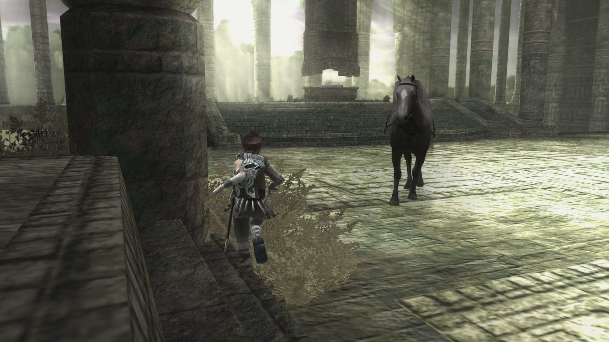
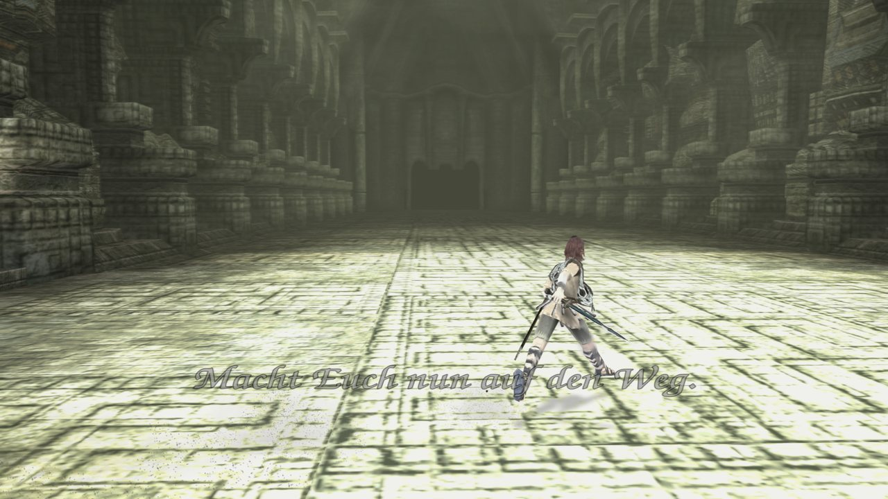
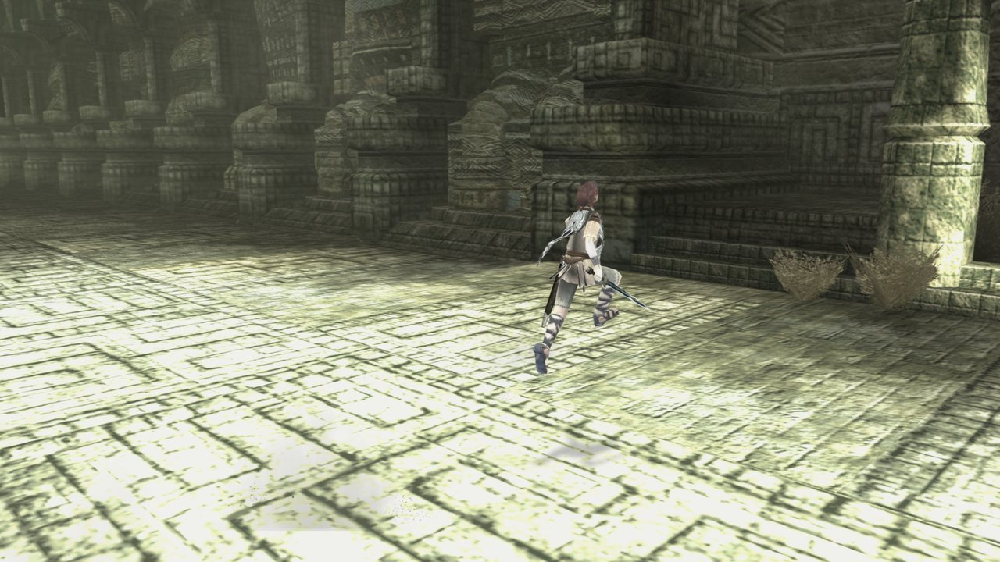
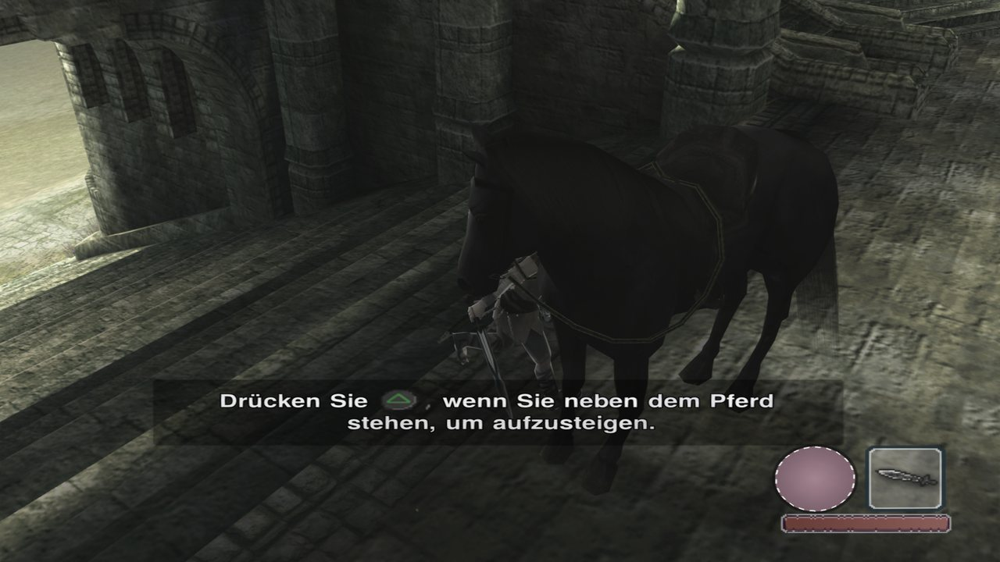
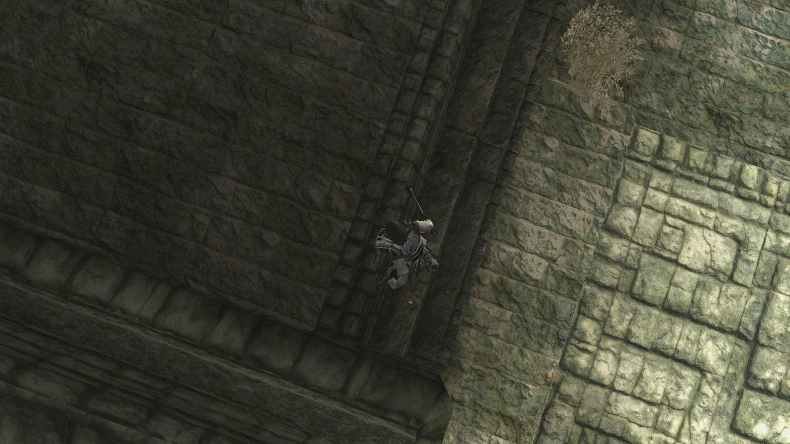
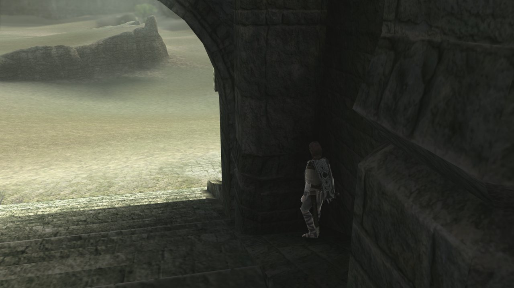
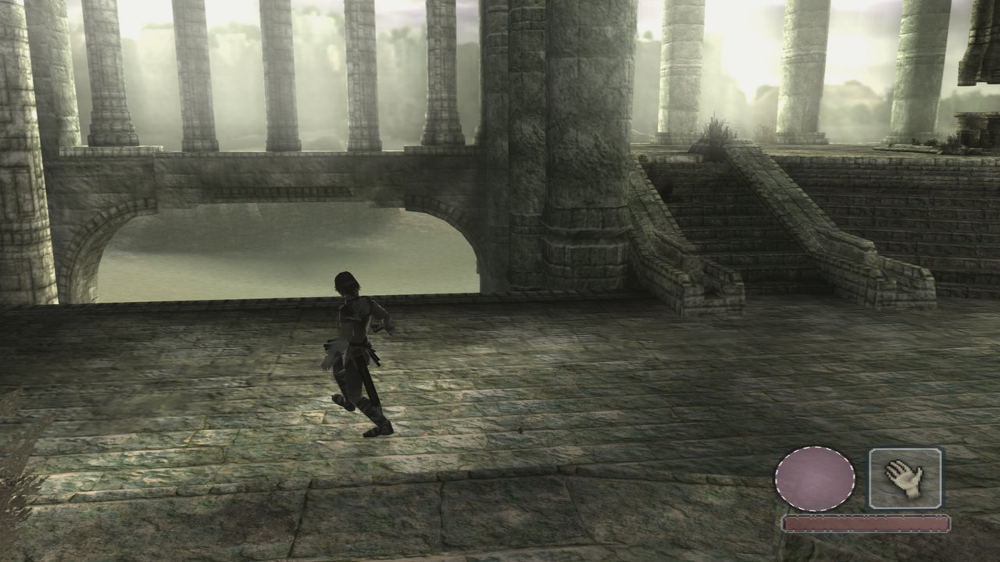
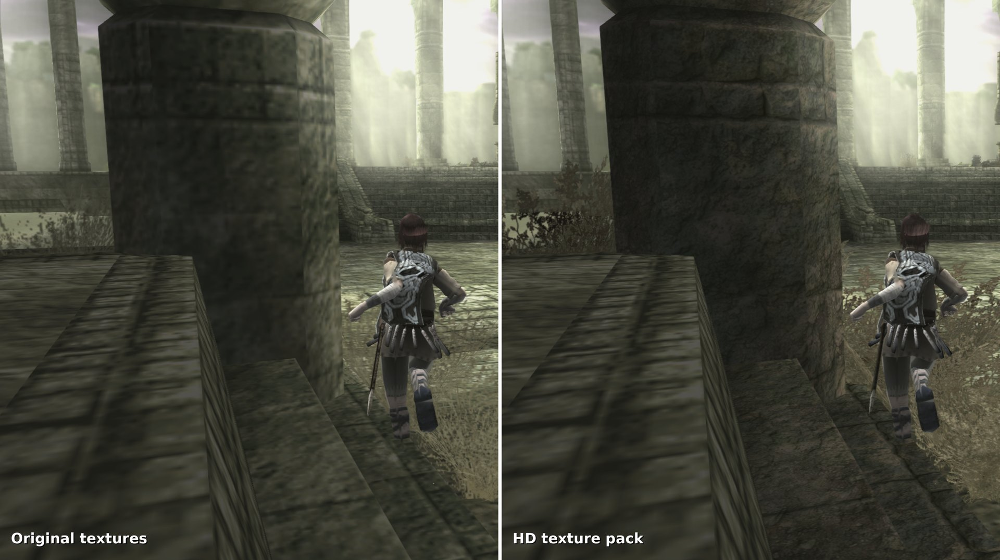
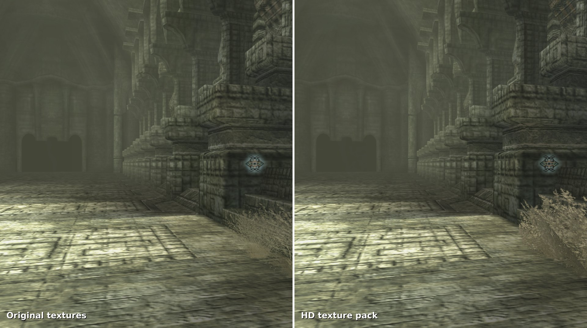
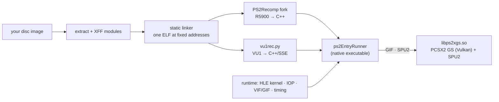

<div align="center">



# Shadow of the Colossus — Native Linux Port

**The PS2 game, statically recompiled into a native Linux executable and rebuilt as an HD remaster.**

No CPU emulation at runtime · verified against PCSX2 · 60 FPS · 4× resolution · HD texture packs · HD text

[](docs/KNOWN_ISSUES.md)
[](docs/BUILDING.md)
[](gsbridge/)
[](LICENSE)

[Gallery](#gallery) · [Overview](#overview) · [Testing](#testing) · [Performance](#performance) · [Status](#status) · [Install](#install-and-build) · [Docs](#documentation)

</div>

> [!IMPORTANT]
> **Work in progress, not a release.** You need your own disc. This repository contains no game code, no game
> assets and no BIOS; the pipeline turns *your* dump into *your* build on *your* machine.

## Gallery

<table>
<tr>
<td></td>
<td></td>
</tr>
<tr>
<td></td>
<td></td>
</tr>
<tr>
<td></td>
<td></td>
</tr>
</table>

<sub>Native port running the author's own PAL disc: 4× internal resolution, 16× anisotropic filtering, FXAA + CAS,
Sad Origami's HD texture pack (alpha-corrected, see below), HD text. No AI upscaling of the rendered frame.</sub>

### Texture pack, same frame




<sub>Left: the game's own textures at 4×. Right: the identical frame of a deterministic input replay with the HD pack.
Unpaced benchmark: 88.2 FPS with the pack, 88.8 FPS without.</sub>

### Text, same page


<sub>Left: original 128–512 px text pages. Right: our 4× re-typeset pages (OCR, hand-corrected, free fonts, original
layout). Texture packs that ship their own text pages (all five languages) take priority; ours fill the gaps.</sub>

## Overview

| | |
|---|---|
| **Ahead-of-time translation** | R5900 code, VU0 macro code and all 21 VU1 micro programs are translated to C++ and compiled into one executable. No interpreter or JIT on the hot path. |
| **Verified, not eyeballed** | Player, camera and physics match PCSX2 on the same input recording; 10 translation bugs in the upstream recompiler were found this way and fixed. → [FINDINGS](docs/FINDINGS.md) |
| **PCSX2's renderer, in-process** | Only the GS (Vulkan) and SPU2 come from PCSX2, linked as a library. None of its CPU emulation runs. → [`gsbridge/`](gsbridge/) |
| **Texture packs at full speed** | PCSX2-format packs load directly. Two generic slowdowns in such packs (PS2 alpha overshoot, replaced palette textures) are fixed by tools that work for any game. → [PERFORMANCE](docs/PERFORMANCE.md#texture-packs-making-them-fast) |
| **In-game menu** | Resolution, filtering, FXAA/CAS, texture packs, HD text, vkBasalt looks and rumble strength, switchable while playing. |
| **Linux installer** | Menu entry with icon, disc-image picker, texture-pack import. |

## Testing

Every change is checked against recorded play sessions and a reference emulator before it is kept.

| | |
|---|---|
| Automated jobs | **1,200+** through a job queue on the development machine (builds, replays, comparisons) |
| Replay runs | **550+** headless runs of recorded sessions, **2.2 million frames** replayed (≈ 10 hours of gameplay at 60 FPS) |
| Screenshots compared | **2,700+** pixel-by-pixel comparisons across builds; the standard regression set (36 frames, 3 routes) must stay bit-identical |
| Runtime builds | **200+** numbered builds (`pc1` … `pc166`), profile-guided |
| VU1 equivalence | compiled VU1 vs. the cycle-accurate interpreter: 0 mismatches over **20 million** program invocations |
| Reference runs | PCSX2 driven with the same recordings via a virtual pad; RAM snapshots compared field by field |
| Recorded sessions | 12, from boot to the first colossus fight |

Method: [docs/VERIFICATION.md](docs/VERIFICATION.md). Development started 1 November 2026.

## Performance

Unpaced benchmarks (the game itself runs at a fixed 60/50 FPS; these show the headroom), 4× resolution, HD texture pack,
AMD Ryzen 9 7950X + Radeon RX 7900 XT:

| Scene | Average | Slowest 50-frame window |
|---|---:|---:|
| Open world, shrine route (5,500 frames) | 88 FPS | — |
| First colossus fight (28,256 frames, `pc164`) | **94 FPS** | 76 FPS (excluding the initial load) |

VU1 thread time on the same open-world replay went from 83 s to 43 s in bit-exact compiler steps; in the colossus replay
the VU1 thread is busy about half of the time. Details: [docs/PERFORMANCE.md](docs/PERFORMANCE.md).

## Status

| Area | State | Notes |
|---|:-:|---|
| Boot, intro, title/language/60 Hz menus | ✅ | |
| Open world, riding, climbing, save/load | ✅ | verified against PCSX2 on recorded routes |
| Colossus fights | ✅ | first colossus defeated natively; in-game save works |
| Sound and music (SPU2 + the game's own IOP sound driver) | ✅ | |
| 60 Hz mode | ✅ | |
| Texture packs | ✅ | live switching in the *Textures* tab |
| HD text | ✅ | pack text pages (all languages) first, own re-typeset German pages as fallback |
| Settings menu, effects | 🚧 | graphics, textures, effects done |
| Linux installer | 🚧 | works; polishing |
| Rumble | ✅ | both DualShock 2 motors forwarded to the gamepad; strength slider in the menu |
| Windows | ⬜ | later, as a separate project |
| NTSC-U/J | ⬜ | different module layout |

Open problems and fixed-bug history: [docs/KNOWN_ISSUES.md](docs/KNOWN_ISSUES.md).

## Install and build

```sh
tools/setup_cachyos.sh                       # toolchain + dependencies (CachyOS / Arch)
SOTC_ISO=/path/to/your/own/dump.iso \
tools/pipeline.sh                            # your ISO → modules → linked ELF → generated C++
tools/pc_bauen_pgo.sh pc1                    # build the runtime (profile-guided)
tools/installieren.sh                        # menu entry + icon, disc image, texture-pack import
```

- The GS/SPU2 library is built once from a pinned PCSX2 commit with [`gsbridge/`](gsbridge/) applied.
- Texture packs: put the PCSX2-format archive you downloaded (e.g. Sad Origami's PAL remaster, `SCES-53326`) into
  `texturpakete/`; the installer imports it.
- Optional effects: [vkBasalt](https://github.com/DadSchoorse/vkBasalt) (`sudo pacman -S vkbasalt`).
- Uninstall: `tools/installieren.sh --entfernen` (saves and settings stay).

Full guide: [docs/BUILDING.md](docs/BUILDING.md).

## How it works



Generated code is produced on your machine and never committed.

## Documentation

| | |
|---|---|
| [ARCHITECTURE](docs/ARCHITECTURE.md) | game structure, pipeline, runtime, VU1 compiler, timing |
| [FINDINGS](docs/FINDINGS.md) | correctness bugs found against the reference, and the upstream fixes |
| [PERFORMANCE](docs/PERFORMANCE.md) | VU1 optimisation log, colossus benchmark, texture-pack fixes |
| [VERIFICATION](docs/VERIFICATION.md) | replays, screenshot regression, RAM vs. PCSX2, differential VU1 testing |
| [BUILDING](docs/BUILDING.md) | step-by-step build |
| [TOOLS](docs/TOOLS.md) | the tools written for this port |
| [KNOWN_ISSUES](docs/KNOWN_ISSUES.md) | open issues and fixed-bug history |

## Legal

- Original tooling and runtime code under GPL-3.0 (the recompiler/runtime are a fork of PS2Recomp, also GPL-3.0), plus a
  patch and bridge for PCSX2 (LGPL-3.0).
- **No code, data, textures, text, audio or BIOS from the game or from Sony.** Generated translations of the game's code
  are produced locally from your own disc and are ignored by `.gitignore`.
- You must own the game and dump your own disc. Do not share dumps, generated code or texture packs derived from game
  assets.
- *Shadow of the Colossus* is a trademark of Sony Interactive Entertainment. This project is not affiliated with or
  endorsed by Sony, Team ICO/Japan Studio or Bluepoint Games.
- Screenshots in `docs/screenshots/` were taken from the port running the author's own disc.

## Credits

[PS2Recomp](https://github.com/ran-j/PS2Recomp) (recompiler and runtime base) ·
[PCSX2](https://pcsx2.net) (GS/SPU2, and the reference for hardware behaviour) ·
[sotc-decomp](https://github.com/TheRealestNwah/sotc-decomp) (decompilation research) ·
[ps2autotests](https://github.com/unknownbrackets/ps2autotests) (hardware test vectors) ·
Sad Origami (the PAL HD texture pack shown in the screenshots; not included) ·
Tesseract OCR and TeX Gyre fonts (HD text).

## Development

Built by a human maintainer together with Claude (Anthropic) working as a coding agent. The maintainer sets direction,
owns the hardware and testing and makes the decisions; the agent did most of the reverse engineering, implementation,
measurement and documentation. Every change is measured and checked against the reference as described above.
