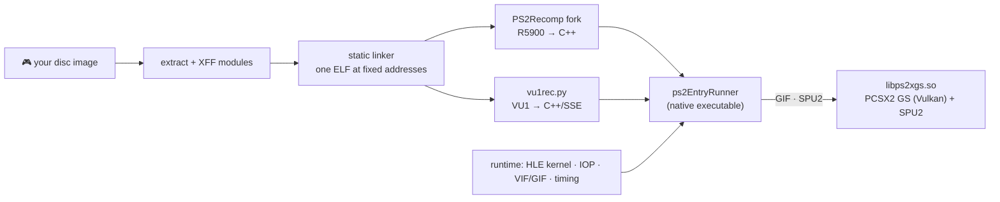

<div align="center">


# Shadow of the Colossus — Native Linux Port

**The PS2 classic, statically recompiled into a native Linux executable and rebuilt as an HD remaster.**<br>
No CPU emulation at runtime · bit-exact against the console reference · 60 FPS · 4× resolution · HD texture packs · re-typeset HD text

[](docs/KNOWN_ISSUES.md)
[](docs/BUILDING.md)
[](gsbridge/)
[](LICENSE)

[Gallery](#-gallery) · [What's inside](#-whats-inside) · [Status](#-status) · [Install](#-install--build) · [Docs](#-documentation) · [Legal](#%EF%B8%8F-legal)

</div>

> [!WARNING]
> **Work in progress.** Fast-moving, not a release. You need **your own disc** — this repository contains
> no game code, no game assets and no BIOS. The pipeline turns *your* dump into *your* build on *your* machine.

---

## 🖼️ Gallery

<sub>All screenshots: the native port running the author's own PAL disc, 4× internal resolution, 16× anisotropic filtering,
FXAA + CAS, Sad Origami's HD texture pack (alpha-fixed), re-typeset HD text. No AI upscaling of the frame.</sub>

<table>
<tr>
<td></td>
<td></td>
</tr>
<tr>
<td></td>
<td></td>
</tr>
<tr>
<td></td>
<td></td>
</tr>
</table>

### HD texture pack — same frame, same settings

<div align="center">


<sub>Left: the game's own textures at 4× resolution. Right: the identical frame and crop (deterministic input replay) with the HD pack.
After our fixes the pack runs at <b>88.2 FPS vs 88.8 FPS</b> without it (unpaced benchmark).</sub>
</div>

### HD text — re-typeset, not AI-upscaled

<div align="center">

<sub>Left: the original 128–512 px text pages. Right: the same pages detected, OCR'd, corrected and re-rendered at 4× with free
fonts (TeX Gyre Heros / Chorus) in the original layout; button icons kept.</sub>
</div>

---

## ✨ What's inside

| | |
|---|---|
| 🧠 **Ahead-of-time translated** | The R5900 MIPS code, VU0 macro code and **all 21 VU1 micro programs** are translated to C++ and compiled into one executable. No interpreter, no JIT. |
| 📏 **Bit-exact** | Player, camera and physics match PCSX2 to the last digit on the same input recording; three runs under full load are bit-identical. 10 translation bugs in the upstream recompiler found and fixed. → [FINDINGS](docs/FINDINGS.md) |
| 🚀 **Fast** | One frame per VBlank: 60 FPS (NTSC mode) / 50 FPS (PAL). Unpaced: **~88 FPS** at 4× with the HD pack. VU1 thread time cut **83 s → 43 s** in bit-exact steps. → [PERFORMANCE](docs/PERFORMANCE.md) |
| 🎨 **PCSX2's renderer, in-process** | Only the GS (Vulkan) and SPU2 come from PCSX2, linked as a library — none of its CPU emulation runs. → [`gsbridge/`](gsbridge/) |
| 🖼️ **Texture packs at full speed** | PCSX2-format packs load directly. Two generic slowdowns found in PCSX2 packs (PS2 alpha overshoot, replaced palette textures) and fixed with tools that work for any game. |
| 🔤 **HD text** | Menu, subtitle and tutorial textures re-typeset at 4× — sharp text without AI. |
| 🎛️ **In-game menu** | Resolution, filtering, FXAA/CAS, texture packs and HD text switchable live; optional ReShade-style looks via vkBasalt. |
| 🐧 **Linux installer** | One script: menu entry with icon, disc-image picker, texture-pack import. |

---

## 📊 Status

| Area | | Notes |
|---|:-:|---|
| Boot, intro, title/language/60 Hz menus | ✅ | |
| Open world, riding, climbing, save/load | ✅ | verified bit-exact vs. PCSX2 on recorded routes |
| Colossus fights | ✅ | first colossus defeated natively, in-game save works; all VU1 code compiled statically |
| Sound & music (SPU2 + real IOP sound driver) | ✅ | |
| 60 Hz mode | ✅ | |
| Texture packs | ✅ | full speed, live switching in the *Textures* tab |
| HD text | 🚧 | German intro/menu/tutorial pages done; other languages and later pages pending |
| In-game settings menu, effects | 🚧 | graphics, textures and effects done; more to come |
| Linux installer | 🚧 | works, being polished |
| Rumble | ⬜ | planned |
| Windows | ⬜ | separate project, later |
| Other regions (NTSC-U/J) | ⬜ | needs a new module layout |

Open problems and the fixed-bug history: **[docs/KNOWN_ISSUES.md](docs/KNOWN_ISSUES.md)**.

---

## 📦 Install & build

```sh
tools/setup_cachyos.sh                       # toolchain + dependencies (CachyOS / Arch)
SOTC_ISO=/path/to/your/own/dump.iso \
tools/pipeline.sh                            # your ISO → modules → linked ELF → generated C++
tools/pc_bauen_pgo.sh pc1                    # build the runtime (profile-guided)
tools/installieren.sh                        # menu entry + icon, picks your disc image, imports texture packs
```

- The GS/SPU2 library is built once from a pinned PCSX2 commit with [`gsbridge/`](gsbridge/) applied.
- **Texture packs:** drop the PCSX2-format pack archive you downloaded (e.g. *Sad Origami*'s PAL remaster for
  `SCES-53326`) into `texturpakete/`; the installer imports it and the in-game **Textures** tab switches it.
- **Effects (optional):** install [vkBasalt](https://github.com/DadSchoorse/vkBasalt) (`sudo pacman -S vkbasalt`)
  and choose a look in the menu.
- Uninstall: `tools/installieren.sh --entfernen` (saves and settings stay).

Full guide: **[docs/BUILDING.md](docs/BUILDING.md)**.

---

## 🏗️ How it works



Generated code is produced on your machine and never committed.

## 📚 Documentation

| | |
|---|---|
| [ARCHITECTURE](docs/ARCHITECTURE.md) | game structure, pipeline, runtime, VU1 compiler, timing |
| [FINDINGS](docs/FINDINGS.md) | every correctness bug found against the reference, and the upstream fixes |
| [PERFORMANCE](docs/PERFORMANCE.md) | the VU1 optimisation log and the texture-pack speed fixes |
| [VERIFICATION](docs/VERIFICATION.md) | replays, screenshot regression, RAM vs. PCSX2, differential VU1 testing |
| [BUILDING](docs/BUILDING.md) | step-by-step build |
| [TOOLS](docs/TOOLS.md) | the ~80 tools written for this port |
| [KNOWN_ISSUES](docs/KNOWN_ISSUES.md) | what's open, what was fixed |

## 🧭 What's next

- More VU1 headroom for the heaviest colossus moments.
- HD text for the remaining pages and languages.
- Settings menu polish, rumble, installer polish — then Windows as its own project.

---

## ⚖️ Legal

- Only original tooling and runtime code, GPL-3.0 (the recompiler/runtime are a fork of PS2Recomp, also GPL-3.0),
  plus a patch and bridge for PCSX2 (LGPL-3.0).
- **No code, data, textures, text, audio or BIOS from the game or from Sony.** Generated translations of the game's
  code are produced locally from your own disc and are ignored by `.gitignore`.
- You must own the game and dump your own disc. Don't share dumps, generated code or texture packs derived from
  game assets.
- *Shadow of the Colossus* is a trademark of Sony Interactive Entertainment. Not affiliated with or endorsed by Sony,
  Team ICO/Japan Studio or Bluepoint Games.
- Screenshots in `docs/screenshots/` were taken from the port running the author's own disc dump.

## 🙏 Credits

[PS2Recomp](https://github.com/ran-j/PS2Recomp) — the recompiler and runtime this is built on ·
[PCSX2](https://pcsx2.net) — GS/SPU2 and the reference for every hardware question ·
[sotc-decomp](https://github.com/TheRealestNwah/sotc-decomp) — decompilation research ·
[ps2autotests](https://github.com/unknownbrackets/ps2autotests) — hardware test vectors ·
*Sad Origami* — the PAL HD texture pack shown in the screenshots (not included here) ·
Tesseract OCR and TeX Gyre fonts — HD text.

## 🤖 How this was built

Developed by a human maintainer together with **Claude (Anthropic)** as an autonomous coding agent: the human owns the
direction, hardware, testing and every decision that matters; the agent did most of the reverse engineering,
implementation, measurement and writing — including this README. Yes, it's "vibe coded". It is also measured,
replay-tested and checked against a reference at every step, which is the part that counts.
